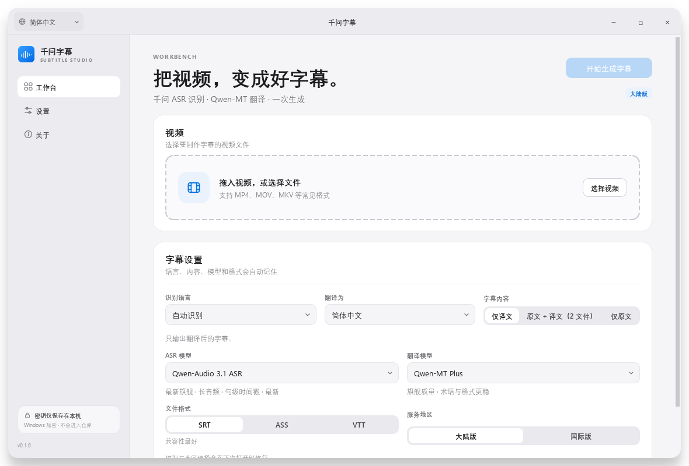

# 千问字幕 · Qwen Subtitle

把视频变成 SRT / ASS / VTT 字幕。语音识别使用千问 ASR，翻译使用 Qwen-MT，桌面界面采用 Apple 风格的浅色设计。



> 一个独立的桌面工具，不是阿里云官方产品。仓库为公开仓库，**不包含任何 API Key 或个人身份信息**。

## 特性

- **最新 ASR 默认，模型可选**：默认 `qwen-audio-3.1-asr-flash-filetrans`，同时提供 Qwen-Audio 3.0 与轻量的 Qwen3-ASR 作为备选。
- **翻译模型可选**：Qwen-MT Plus（推荐）、Qwen-MT Flash。
- **三个输出内容模式**：仅原文 / 仅译文 / 原文 + 译文（分别生成两个文件）。选择「仅原文」时**不会发起任何翻译请求，不消耗翻译 token**。
- **大陆版 / 国际版**：分别使用北京与新加坡地域的 API Key，界面内切换。
- **字幕格式**：SRT、ASS、VTT。
- **语言选择**：识别语言与目标语言可选，覆盖常见语种。
- **两阶段进度**：语音识别 → 翻译 → 写出字幕；完成后弹窗，可一键打开输出文件夹。
- **选择会被记住**：地区、ASR 模型、翻译模型、语言、内容模式、格式、界面语言都会在下次启动时恢复。
- **三语界面**：简体中文 / English / 日本語，默认简体中文，切换即时生效。
- **密钥只在本机**：用户粘贴 API Key，使用 Windows DPAPI 加密保存；不会写入仓库、日志或命令行。
- **原视频不出本机**：只上传提取出的音频到阿里云百炼；没有遥测、广告或账号系统。

## 直接运行（推荐给普通用户）

**不需要安装 Python，也不需要单独安装 FFmpeg。**

- 系统：Windows 10 / 11 64 位。
- 获取 `QwenSubtitle-portable-0.1.0-win64.zip`（发布时放在 GitHub Releases，或在本机执行构建脚本后位于 `dist\`）。
- 解压 ZIP，双击里面的 `QwenSubtitle\QwenSubtitle.exe` 即可。**不要只把 EXE 单独拿出来**，它需要同目录的 `_internal` 运行时文件。
- 目录版不会把运行时解压到系统 `%TEMP%`，因此普通用户/受限配置下也能启动；这是默认分发形式。
- 当前构建没有代码签名。Windows SmartScreen 可能提示“未知发布者”，此时请确认文件来源和校验值后再运行。发布页同时提供 `QwenSubtitle-portable.sha256`，可用 `Get-FileHash -Algorithm SHA256 .\QwenSubtitle\QwenSubtitle.exe` 核对。
- 单文件 `--onefile` 模式仍然可用作实验，但它依赖可写的 `%TEMP%`；在部分 Windows 策略下会报 `Could not create temporary directory!`，因此不作为默认分发。

> 公开仓库不直接提交 EXE 二进制；请在 GitHub Releases 下载。构建说明见[打包](#打包)。

## 从源码运行（开发）

需要 Windows 10/11、Python 3.11+、网络可访问阿里云百炼。FFmpeg 会优先使用手动指定的路径，其次应用内置版本（打包时）、系统 PATH，最后使用 `imageio-ffmpeg` 自带的二进制。

```powershell
git clone <your-fork-url>
cd video_subtitles

python -m venv .venv
.\.venv\Scripts\Activate.ps1
python -m pip install --upgrade pip
python -m pip install -e ".[dev]"

python run.py
```

也可以直接：

```powershell
python -m qwen_subtitle
```

### 第一次使用

1. 打开「设置」，选择**大陆版**或**国际版**。
2. 到对应的百炼控制台获取 API Key：
   - 大陆版：[阿里云百炼](https://bailian.console.aliyun.com/)
   - 国际版：[Alibaba Cloud Model Studio](https://modelstudio.console.alibabacloud.com/)
3. 粘贴 Key，点击「保存密钥」。只会保存到本机。
4. 回到「工作台」，拖入视频或点击「选择视频」。
5. 选择识别语言、翻译语言、字幕内容和模型。
6. 点击「开始生成字幕」，等待识别与翻译完成。
7. 完成后弹窗中点击「打开文件夹」即可定位字幕文件。

> 大陆版与国际版的 API Key 不通用。不同账号、不同业务空间的模型权限也可能不同。

## 输出模式与 token 消耗

| 模式 | 输出 | 翻译请求 |
| --- | --- | --- |
| 仅原文 | `视频名.original.srt` | **跳过 Qwen-MT，完全不消耗翻译 token** |
| 仅译文 | `视频名.<目标语言>.srt` | 发送字幕文本到 Qwen-MT |
| 原文 + 译文 | `视频名.original.srt` + `视频名.<目标语言>.srt` | 发送字幕文本到 Qwen-MT，分别生成独立的原文文件和译文文件 |

如果同名文件已存在，会自动使用 `视频名.zh-Hans (2).srt`，不会覆盖已有文件。

## 模型

### ASR

| 模型 | 定位 | 默认 |
| --- | --- | --- |
| `qwen-audio-3.1-asr-flash-filetrans` | 千问当前最新长音频识别模型，多语种与中文方言，句级时间戳 | ✅ |
| `qwen-audio-3.0-asr-flash-filetrans` | 上一代旗舰，兼容性备选 |  |
| `qwen3-asr-flash-filetrans` | 轻量、快速、成本低 |  |

默认值是新模型，但不会锁定：用户选择后会立即保存，并在下一次启动时恢复。应用不会在启动时静默把用户的选择换回默认值。

### 翻译

| 模型 | 定位 | 默认 |
| --- | --- | --- |
| `qwen-mt-plus` | 旗舰级，92 种语言，术语与格式更稳 | ✅ |
| `qwen-mt-flash` | 轻量级，92 种语言，速度与成本平衡 |  |

> Qwen-MT Lite 官方仍存在，但部分仅含免费额度的账户会报 `AllocationQuota.FreeTierOnly`，因此当前版本不提供 Lite；需要时请改用 Flash，或在百炼控制台开通付费额度。

API 参考：[非实时语音识别](https://help.aliyun.com/zh/model-studio/non-realtime-speech-recognition-user-guide)、[Qwen-MT](https://help.aliyun.com/zh/model-studio/machine-translation)。模型与接口可能调整，详见 [docs/API_NOTES.md](docs/API_NOTES.md)。

## 界面语言

**标题栏最左侧**有语言下拉菜单，任何页面都能切换；「设置 → 界面语言」也可以切换：

- 简体中文（默认）
- English
- 日本語

切换立即生效，并写入本机设置。所有界面文案、模型说明、进度提示和常见错误都通过同一套本地化层输出。

## 隐私与安全

- **不收集遥测**：没有分析、广告、账号或云端同步。
- **视频留在本机**：应用只用 FFmpeg 提取 16 kHz 单声道音频。
- **音频上传**：识别时，提取出的音频会临时上传到阿里云百炼，文件与模型绑定且有时效限制。详见 [PRIVACY.md](PRIVACY.md)。
- **翻译文本上传**：仅译文/双语模式会把字幕文本发送给 Qwen-MT；仅原文模式不会发送。
- **API Key**：使用 Windows DPAPI（`CryptProtectData`）按当前 Windows 用户加密，保存在 `%LOCALAPPDATA%\QwenSubtitle\secrets.bin`；若该目录对当前进程不可写，则回退到 EXE 同级 `portable-data`。仓库内没有密钥，也没有 `.env`。
- **公开仓库**：提交前运行安全检查：

```powershell
python scripts/check_public_repo.py
```

更多：[SECURITY.md](SECURITY.md)、[PRIVACY.md](PRIVACY.md)。

## 工程结构

```text
video_subtitles/
├─ src/qwen_subtitle/
│  ├─ app.py                  # 启动、日志、主题
│  ├─ constants.py            # 模型/语言/格式/地区目录
│  ├─ i18n.py                 # 中/日/英界面文案
│  ├─ core/
│  │  ├─ config.py            # 非敏感设置持久化
│  │  ├─ secrets.py           # DPAPI 密钥存储
│  │  ├─ dashscope.py         # 上传、ASR、Qwen-MT HTTP 客户端
│  │  ├─ ffmpeg.py            # 媒体探测、音频提取、缩略图
│  │  ├─ subtitle.py          # 字幕切分与 SRT/ASS/VTT 写出
│  │  └─ pipeline.py          # ASR → 翻译 → 写出
│  └─ ui/
│     ├─ main_window.py       # 无边框窗口、侧栏、标题栏
│     ├─ pages/               # 工作台 / 设置 / 关于
│     ├─ dialogs.py           # 完成、错误、确认弹窗
│     └─ widgets.py           # 分段控件、进度步骤、文件卡片
├─ tests/                     # 单元测试与离屏 UI 冒烟测试
├─ docs/                      # 产品、架构、API、设计、测试与交接文档
├─ scripts/                   # 开发、EXE 构建、图标、公开仓库检查
├─ assets/                    # 应用图标与 Windows 版本信息
├─ run.py                     # 源码启动入口（也可被 PyInstaller 使用）
└─ pyproject.toml
```

## 开发与测试

```powershell
python -m pytest
python scripts/check_public_repo.py
```

完整测试与手动验收清单见 [docs/TESTING.md](docs/TESTING.md)。

## 打包为便携目录版

```powershell
powershell -ExecutionPolicy Bypass -File scripts/build.ps1
```

输出：

- `dist\portable\QwenSubtitle\QwenSubtitle.exe`：目录版 EXE，内含 Python 运行时、PySide6、应用资源和 FFmpeg。
- `dist\QwenSubtitle-portable-0.1.0-win64.zip`：可直接分发的压缩包（含整个 `QwenSubtitle` 文件夹）。
- `dist\QwenSubtitle-portable.sha256`：EXE 的 SHA-256 校验值。
- `dist\QwenSubtitle-portable-zip.sha256`：ZIP 本身的 SHA-256 校验值。

构建脚本使用 PyInstaller 的目录模式，并把 `imageio-ffmpeg` 的 FFmpeg 二进制一起收集。构建完成后会自动用 `--self-test` 启动打包产物，校验 Qt 离屏界面、内置 FFmpeg 和 `%LOCALAPPDATA%` 缓存。首次打包前请确认 [assets/app.ico](assets/app.ico) 存在。

如果本机依赖位于 `.deps`（例如受管工作区），可使用 `scripts/build-local.ps1`。

推送形如 `v0.1.0` 的 Git tag 时，`.github/workflows/release.yml` 会在 Windows runner 上构建便携目录包、运行 `--self-test`、生成 SHA-256，并把 ZIP 附加到 GitHub Release。公开仓库不直接提交二进制。

## 已知限制

- 自动化测试使用模拟的千问响应，**不会也不需要真实 API Key**；首次真实调用仍取决于账号是否开通对应模型。
- 当前只使用官方默认域名（`dashscope.aliyuncs.com` / `dashscope-intl.aliyuncs.com`）。企业业务空间专属域名尚未在设置中开放。
- 密钥存储依赖 Windows DPAPI，当前版本以 Windows 为主要目标。
- 长音频由千问异步任务处理；云端识别期间没有逐秒进度，界面会显示轮询状态。
- EXE 当前未签名，SmartScreen 可能提示“未知发布者”；正式分发建议使用项目自有代码签名证书。
- 默认分发是目录版 ZIP（解压后双击 `QwenSubtitle.exe`），避免单文件模式依赖系统 `%TEMP%` 解压；单文件版仅作为可选实验。
- 界面是 Apple 风格的设计语言，不包含 Apple 商标、SF Pro 字体文件或对 Apple 产品的模仿承诺。

## 路线图

见 [docs/ROADMAP.md](docs/ROADMAP.md)。下一阶段优先考虑：自定义业务空间/域名、深色模式、字幕预览与编辑、术语表/热词、批量队列、签名安装包和真实 API 集成测试。

## 文档

- [产品规格](docs/PRODUCT_SPEC.md)
- [架构设计](docs/ARCHITECTURE.md)
- [架构决策](docs/DECISIONS.md)
- [API 备注](docs/API_NOTES.md)
- [界面设计](docs/UI_DESIGN.md)
- [测试与验收](docs/TESTING.md)
- [路线图](docs/ROADMAP.md)
- [v0.1.0 Release Notes](docs/RELEASE_NOTES_v0.1.0.md)
- [对话交接](docs/HANDOFF.md)
- [贡献指南](CONTRIBUTING.md)
- [安全策略](SECURITY.md)
- [隐私说明](PRIVACY.md)
- [AGENTS.md](AGENTS.md)（面向后续开发对话的工程约束）

## License

MIT。见 [LICENSE](LICENSE)。
